# Collaborative event albums

A host creates a private event album and shares a link or QR code. Guests open
it on their phones and add photos without creating an account. Each link sets
what its guests can do: **add**, **view** and **download**. This is the
implementation of the collaborative event albums plan. Enabling it is a
separate step; see [`../EVENT_ALBUMS_RUNBOOK.md`](../EVENT_ALBUMS_RUNBOOK.md).

The screenshots below come from a real run against the Firestore emulator. The
API used its signed local media store, and the photos are the Unsplash samples
in `client/public/images/samples`.

> **Revised 2026-10-12.** The first version replaced the library's login with
> Firebase Authentication. Render deployed it before Firebase was set up and
> before the matching client was released, which broke the live library, so
> it was rolled back. Event albums now sit **next to** the unchanged library,
> as described under "Foundation".

## What was built

### Foundation (Phase 1)

- **The personal library is unchanged.** Its routes and the client calls that
  use them work exactly as before, including the email-based requests. Old
  and new clients both keep working.
- **Host sign-in for event albums.**
  - The existing `/api/login` and `/register` also return a signed host
    session token (`albh_…`, HMAC, valid for 30 days).
  - The client keeps the token with the session and sends it as
    `Authorization: Bearer` on event-album requests only.
  - The token is issued only when exactly one account row has that email, and
    registering an existing email is now refused. A duplicate row therefore
    can't act as someone else's host.
  - A host who signed in before this change is asked to log in once more.
- **Isolation.** Event routes check host and guest tokens on every request
  and refuse guest tokens on host routes.
  - Event albums load only when `EVENT_ALBUMS_ENABLED=true`.
  - If they fail to load (missing Firestore credentials, for example), the API
    turns them off and the library keeps running.
  - `GET /api/features` tells the web app whether to show them.
- **Server structure.**
  - `server/app.js` is an importable app with injected services.
  - The library routes live in `routes/legacy.js`.
  - Firestore rules deny all direct access, and the composite indexes are
    checked in.

### Hosts (Phase 2)

- **Event albums page** (`/events`): cover cards with photo count and status
  (Collecting, Uploads closed, Guest access off, Archived). Counts refresh
  while the page is visible.
- **Event page** (`/events/:albumId`): Add photos, Invite guests, Play
  slideshow and Settings.
  - The grid shows who added each photo and when.
  - Each photo's menu has Download, Set as cover, Hide from guests or Show to
    guests, Turn off this guest's session, and Remove.
- **Settings:**
  - Title and date.
  - **Accept guest uploads**, **Allow guest access** and **Archive event**.
  - Usage meters for photos and storage.
  - An honest note about how long signed URLs stay valid.
  - Saves are version-checked, so an edit from another tab is never
    overwritten.

### Invitations and guests (Phase 3)

- **Invitation links.** Each link has a name, its own Add / View / Download
  switches (Download requires View) and an expiry, 30 days by default.
  - A new link is shown once with a QR code, Copy, Share and a printable QR
    card (PNG).
  - The QR code is drawn in the browser.
  - The server keeps only a SHA-256 hash of the link.
  - The list of links offers Revoke and Replace.
- **Joining.** `/join#invite=…` reads the secret from the URL fragment, strips
  it from the address bar and history, and exchanges it for a scoped guest
  session.
  - The session lasts 24 hours, or until the invitation expires if that is
    sooner.
  - The token is kept in `sessionStorage` only.
  - The guest then continues at `/events/:albumId`.
- **Guest pages.** Guests get a minimal header with no account or library
  navigation.
  - Viewing guests browse, preview and play the slideshow. They can download
    originals only if their link allows it.
  - Upload-only guests see just the uploader and their own receipts: no
    gallery, cover, count or other guests' names.
- **Reused components.**
  - `FileSelect` takes an injected upload handler with per-file idempotency
    keys, so a retry never duplicates a photo. It has no collection field in
    event mode, accepts only JPEG, PNG and WebP, and explains HEIC.
  - `PhotoCard`, `Preview` and `Slideshow` accept IDs, titles, action menus
    and signed URLs.

### Phone experience (Phase 4)

- **Phone layout.**
  - Viewing guests and hosts get a sticky **Add photos** bar.
  - The grid uses two columns, and tap targets are large.
  - The layout follows the Lagoon light and dark schemes.
- **Refresh.** Galleries refresh every 60 seconds while visible and when the
  phone brings the tab back. Each refresh renews the signed URLs.
  - An image that already loaded keeps its URL, so it doesn't flash.
  - A failed image asks the server for a fresh URL. If access has changed,
    the page explains why.
- **Access states.** Each has its own message: an invalid, expired or revoked
  link, closed uploads, guest access off, a turned-off session, a missing
  album, and network errors.
- **Homepage.** The homepage gains an event-albums section once the build
  sets `REACT_APP_EVENT_ALBUMS=true`.

## Server design

| Concern | Implementation |
| --- | --- |
| Records | Firestore: `eventAlbums` (+ `photos` subcollection), `eventInvitations`, `guestSessions` (doc ID = token hash), `eventUploads` (reservations), `storageCleanup`, `hosts`, `legacyLinks` |
| Access | `services/access.js` evaluates effective capabilities from the album, invitation and session on **every** request; event-wide switches override every invitation |
| Uploads | Reserve (transaction: access + quota incl. in-flight) → store bytes at `/events/<album>/<photo>.<ext>` (private) → finalize (transaction: re-check access, publish or reject). Idempotency key per file; provider calls never run inside transaction callbacks |
| Image safety | Signature sniffing (JPEG/PNG/WebP; HEIC detected and explained), 20 MB / 50 MP limits, bounded `sharp` decode, orientation applied, all metadata (incl. GPS) dropped |
| Reliability | Abandoned reservations are reconciled (published if bytes landed and access still allows, else released); deletions go through a persistent, retried cleanup queue; counters are released exactly once |
| Media | Fixed variants only (`thumb` 480, `preview` 1920, `original`), signed URLs aligned to the minute and expiring in 2–3 minutes |
| Errors | `{ error: { code, message } }`; 401 expired/missing session, 403 not allowed, 404 not found (also for other hosts' albums), 409 conflicts/quota, 413/415 size/type, 429 rate limits |

## Verification

| Check | Result |
| --- | --- |
| `server`: `npm test` (in-memory) | 54 tests pass |
| `server`: `npm run test:emulators` (Firestore emulator) | 54 tests pass |
| `server`: boot `index.js` with event albums off, and on without Firestore credentials | The library routes work in both cases; in the second, event albums switch off and the API logs `event_albums_unavailable` |
| `client`: `CI=true npm test` | 25 tests pass |
| `client`: `CI=true npm run build` | Compiles with no warnings |
| Browser run (Chrome, Firestore emulator, fake library modules) | Host registers; library requests still carry the email and no token. Host creates an event, an add+view link and an upload-only link. A guest on a phone joins (the secret is gone from the URL; the token is in sessionStorage only) and uploads 2 photos. The upload-only guest uploads with no gallery. The host revokes the link, and the open guest tab loses access on its next request. |

The server suites cover acceptance tests 2–7 and 9 from the plan, at the API
level, plus checks that the library routes are unchanged:

- the five valid permission combinations, plus a rejected download-only link;
- host overrides;
- denied requests on every route;
- cross-album and cross-host IDs;
- forged and expired host tokens;
- upload-only isolation;
- same-name uploads;
- concurrent quota;
- retries and provider failures;
- revocation during an upload;
- hidden photos;
- pagination under concurrent uploads;
- signed-URL expiry and renewal.

## Not done yet

- **Real phones and real QR scans** (acceptance test 8). The browser run used
  phone viewports, not iOS Safari or Android Chrome hardware, and no phone
  camera scanned a printed code over HTTPS.
- **HEIC conversion.** HEIC files are refused with an explanation, as the plan
  allows. Converting them is the high-value follow-up.
- **ImageKit behaviour against the real account.** The private-file upload,
  signed variants and `ik-attachment` downloads follow ImageKit's documented
  API, but they have only been tested through the local signed store. Before
  rollout, check that unsigned, expired and edited-transformation URLs fail.
- **Library security is unchanged.** The plan's foundation (verified host
  identity on library routes, owner-scoped presets, no plaintext passwords)
  is deliberately not applied to the library, so it keeps working exactly as
  before. Event albums are protected; the library is as exposed as it was.
  The Firebase-based foundation is on the API's `event-albums` branch for a
  later, coordinated migration.
- **Production setup.** Firestore, the rules and indexes, and the ImageKit
  checks are runbook steps that haven't been carried out.
- **Shared rate limiting.** Rate limits are kept in memory per instance, which
  is enough for the current single Render instance.

## Screenshots

| | |
| --- | --- |
| 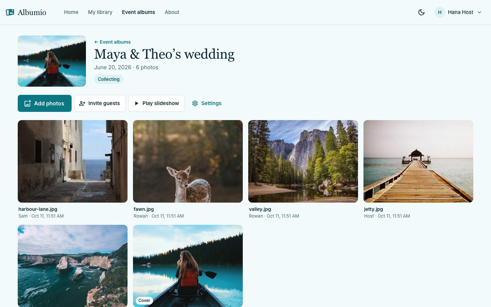 | 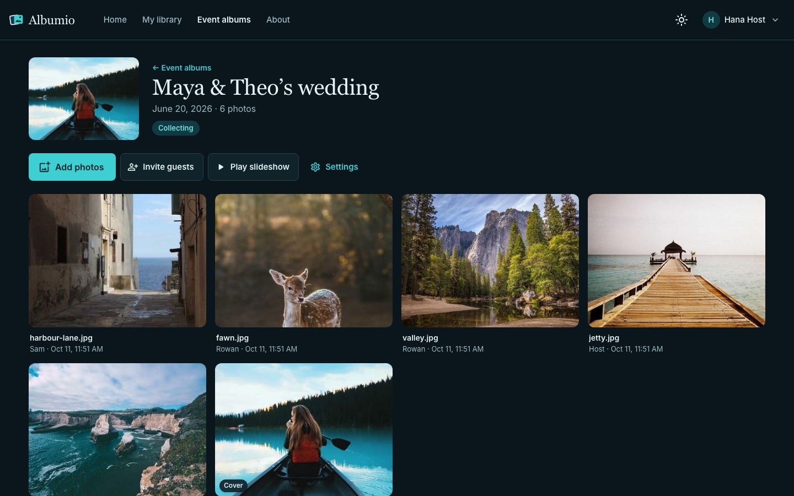 |
| Host event page | Same, dark |
| 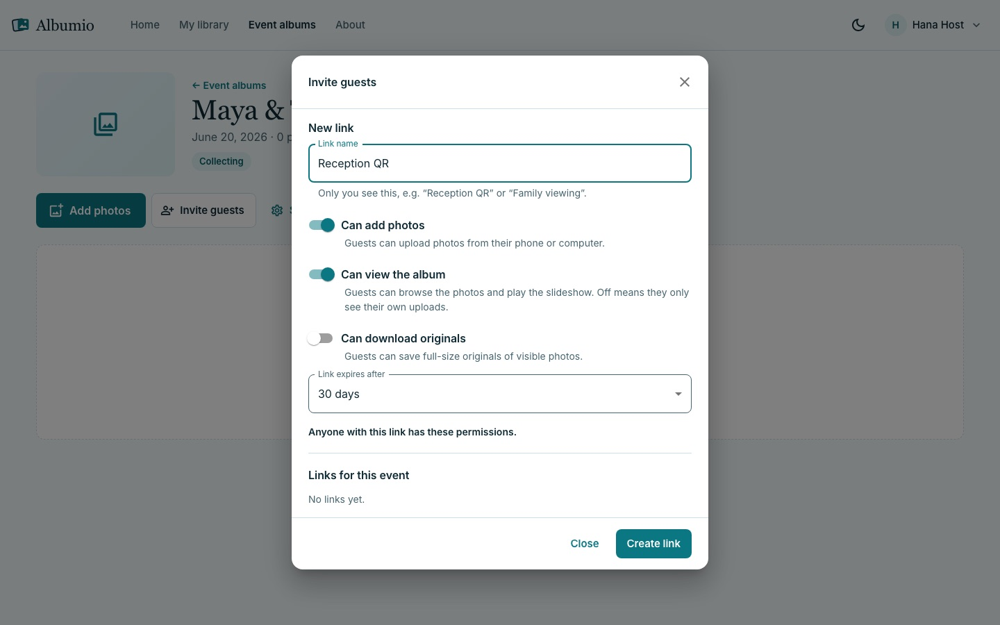 | 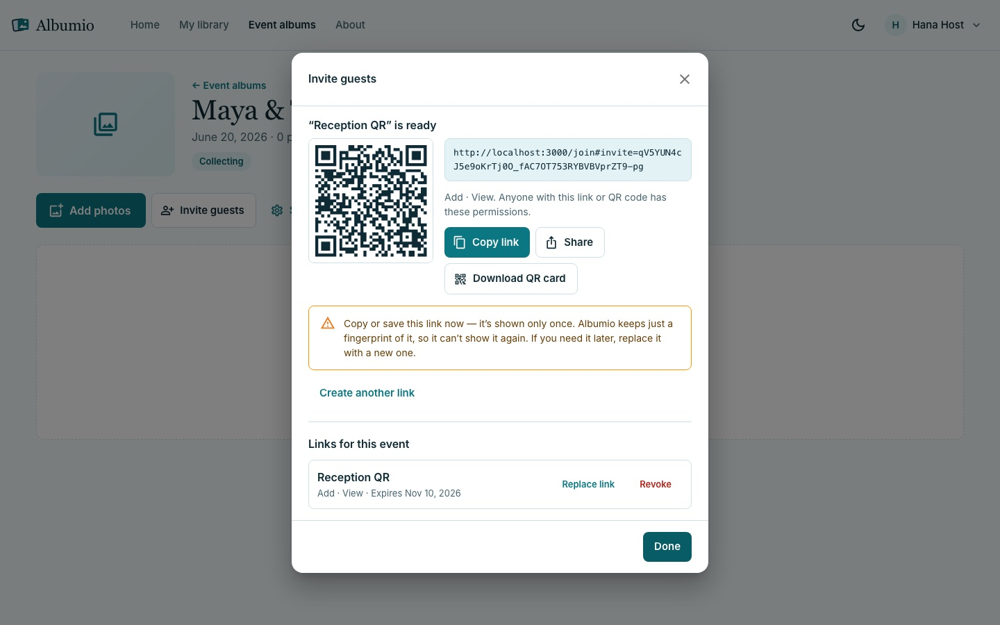 |
| New invitation link | A link shown once, with its QR code |
| 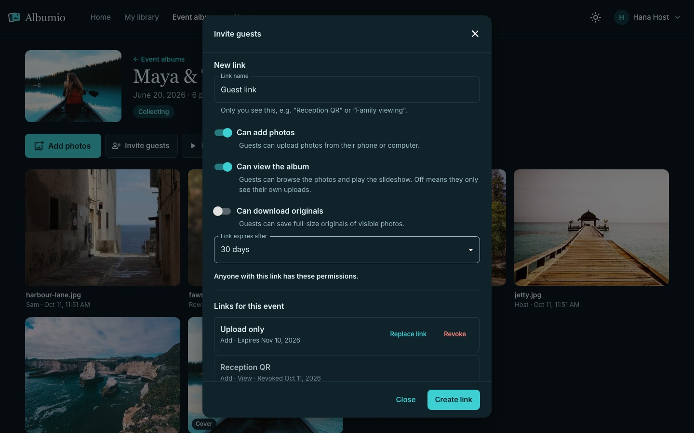 | 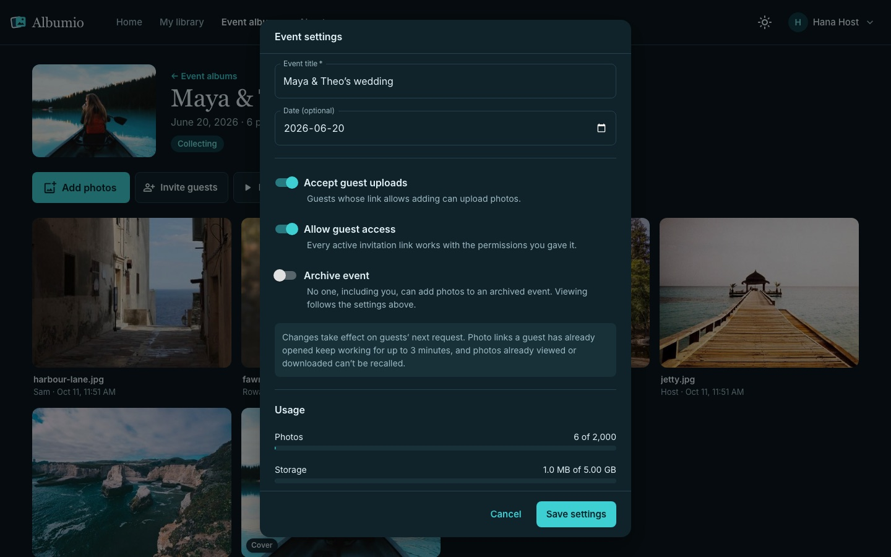 |
| Links for the event, one revoked | Event settings and usage |
| 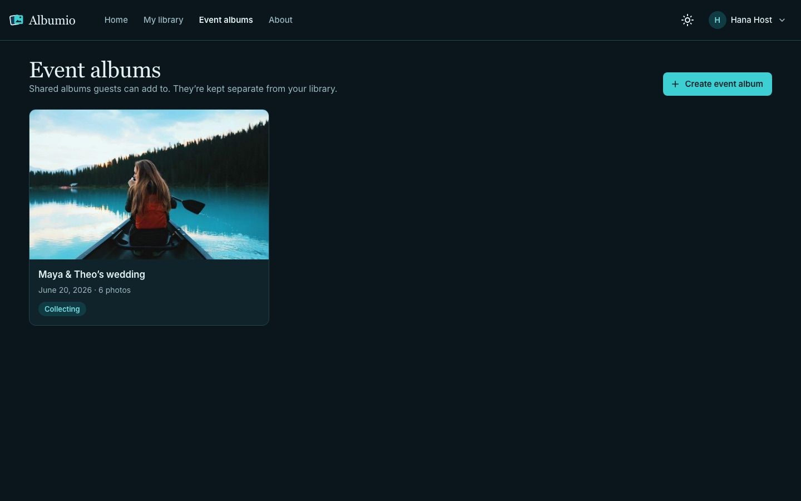 | 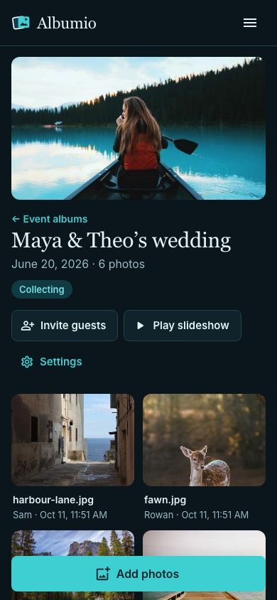 |
| Event albums | Host on a phone |

| | | |
| --- | --- | --- |
| 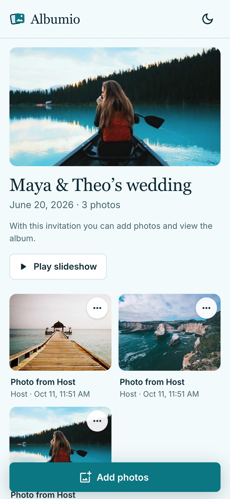 | 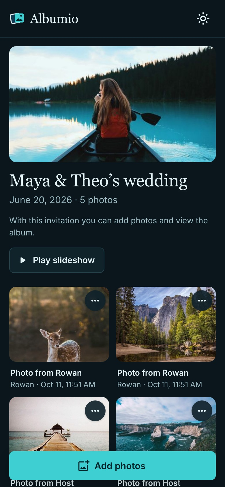 | 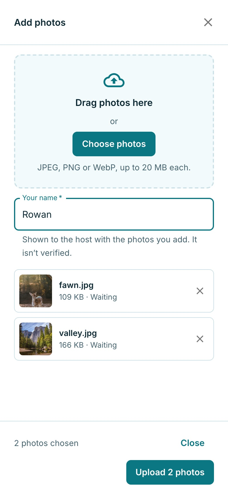 |
| Viewing guest | Same, dark | Adding photos |
| 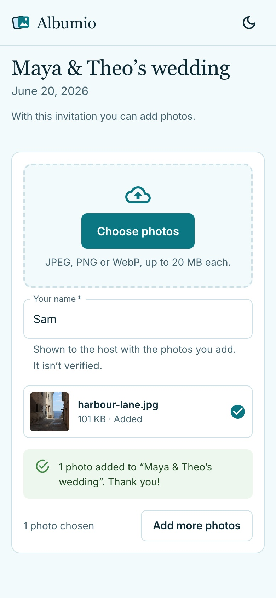 | 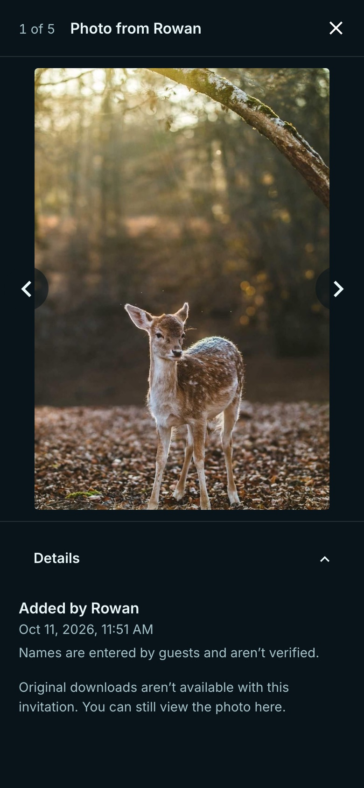 | 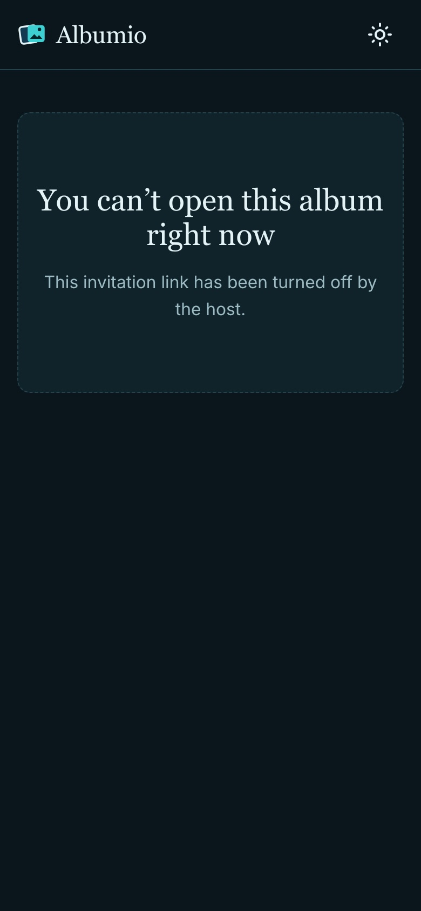 |
| Upload-only guest | Viewer, downloads off | After the host revokes the link |
